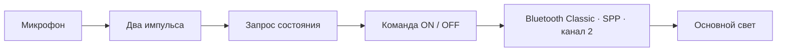

<div align="center">

# 👏 💡 MW-Light Clap

Локальное управление музыкальной люстрой MW-Light с компьютера на Windows.


</div>

---

Два хлопка перед микрофоном — и основной белый свет включается или выключается. Программа читает состояние люстры перед каждой командой, поэтому продолжает правильно работать после переключения с пульта.

Проект родился из попытки вернуть компьютерное управление старой люстрой, приложение которой исчезло из Google Play. Рабочие команды удалось подтвердить по Bluetooth-журналу iLight, а затем воспроизвести напрямую из Python.

## Что умеет

- Распознаёт два коротких импульса с интервалом **180–650 мс**.
- Запрашивает состояние и переключает основной белый свет.
- Управляет лампой вручную из командной строки.
- Работает локально: без облака, аккаунта и телефона во время использования.
- Не сохраняет и не отправляет звук; журнал содержит только события хлопков.
- Имеет демонстрационный режим без команд люстре.

## Совместимость

Проверено владельцем на **MW-Light / De Markt «Норден» 660012901**, Windows и Python 3.13.5. Другие лампы ChipsGuide/iLight могут использовать похожий протокол, но их совместимость не проверена.

Нужны Bluetooth-адаптер с поддержкой Classic, микрофон и включённое питание люстры. RGB-подсветка в этой версии не переключается. Автозапуска и интерфейса в трее пока нет. Детектор эвристический: громкие короткие звуки могут вызывать ложные срабатывания.

## Быстрый старт

Клонируй репозиторий, открой его папку в PowerShell и создай окружение:

```powershell
python -m venv .venv
.\.venv\Scripts\python.exe -m pip install -r requirements.txt
```

Укажи **Bluetooth Classic-адрес своей люстры**. Адрес ниже — пример, его необходимо заменить:

```powershell
$env:MW_LIGHT_ADDRESS = "AA:BB:CC:DD:EE:FF"
```

Адрес можно найти в Windows через свойства Bluetooth-устройства → «Сведения» → «Путь к экземпляру устройства». У записи `BTHENUM\DEV_AABBCCDDEEFF` последние 12 символов задают адрес `AA:BB:CC:DD:EE:FF`.

Отключи iLight на телефоне от люстры, включи Bluetooth компьютера и проверь связь:

```powershell
.\.venv\Scripts\python.exe lamp_transport.py status
```

Если получен `ON` или `OFF`, запускай хлопки:

```powershell
.\.venv\Scripts\python.exe clap_light.py --live
```

**Хлопни дважды.** Оставь окно открытым. Для остановки нажми `Ctrl+C`.

Переменная окружения действует в текущем окне PowerShell. Она не сохраняется в исходниках или репозитории.

## Настройка микрофона

```powershell
# Список устройств
.\.venv\Scripts\python.exe clap_light.py --devices

# Выбор входа по номеру
.\.venv\Scripts\python.exe clap_light.py --live --device 1

# Более чувствительный порог (по умолчанию 0.12)
.\.venv\Scripts\python.exe clap_light.py --live --threshold 0.08

# Проверка распознавания без переключения света
.\.venv\Scripts\python.exe clap_light.py
```

Уменьшай порог, если тихие хлопки не распознаются; увеличивай при ложных срабатываниях. Между парами действует пауза 1,5 секунды. Пока выполняется Bluetooth-команда, новые срабатывания пропускаются.

## Ручное управление

```powershell
.\.venv\Scripts\python.exe lamp_transport.py on
.\.venv\Scripts\python.exe lamp_transport.py off
.\.venv\Scripts\python.exe lamp_transport.py toggle
```

## Как это устроено



Микрофон обрабатывается блоками по 20 мс. Детектор сравнивает пик с порогом и оценкой шума, проверяет отношение пика к RMS и временной интервал. Bluetooth-операции выполняются отдельно от обработки звука.

### Почему не BLE

Люстра также объявляет BLE-службы `6666` и `7777` с характеристиками `8888` и `8877`. В наших проверках запись в `8888` сохраняла байты, но не переключала свет. Работающее iLight использовало **RFCOMM/SPP, канал 2**, на Classic-адресе. BLE-адрес может отличаться от Classic-адреса.

### Подтверждённые пакеты

При подключении отправляется ASCII `01234567`, затем handshake. Поле длины пакета находится в байтах 6–7 и читается как little-endian. Ответы начинаются с `01fe000041`.

| Действие | Пакет, hex |
|---|---|
| Handshake | `01fe0000510210000000008000000080` |
| Состояние белого света | `01fe00005181180000000000000000000d0801020200000e` |
| Включить | `01fe00005181180000000000000000000d07010301010e00` |
| Выключить | `01fe00005181180000000000000000000d07010301020e00` |

Это описание наблюдаемого обмена одной модели, а не официальная спецификация производителя.

## Если не работает

| Симптом | Что проверить |
|---|---|
| Ошибка подключения | Bluetooth Windows включён, адрес Classic указан верно, питание люстры включено |
| Телефон управляет, компьютер — нет | Отключи iLight от люстры: телефон может занимать SPP-канал |
| После отключения не соединяется | Перезапусти питание люстры и повтори запрос `status` |
| Не слышит хлопки | Выбери правильный вход, проверь доступ Windows к микрофону и уменьши порог |
| Срабатывает на посторонние звуки | Увеличь порог и убери микрофон от динамика |

Если лампа отвечает незнакомым форматом, программа сообщает об ошибке, а не угадывает состояние.

## Проверки и границы

Подтверждены: команды с компьютера, чтение состояния, последовательное переключение OFF/ON и полная цепочка с настоящими хлопками. Синтетические проверки детектора покрывают пару импульсов, одиночные хлопки, постоянный громкий звук и паузу после срабатывания. Длительная работа и другие модели пока не проверялись.

В репозитории нет APK, диагностических архивов Android, HCI-журналов и адреса устройства владельца. `events.jsonl` и виртуальное окружение исключены через `.gitignore`.

## Благодарности

Исследование семейства протоколов опиралось на открытые материалы [pfalcon/Chsmartbulb-led-bulb-speaker](https://github.com/pfalcon/Chsmartbulb-led-bulb-speaker) и [samsam2310/Bluetooth-Chsmartbulb-Python-API](https://github.com/samsam2310/Bluetooth-Chsmartbulb-Python-API). Команды этой люстры дополнительно подтверждены собственным захватом iLight и испытанием на устройстве. Проект не связан с MW-Light, De Markt или ChipsGuide.
